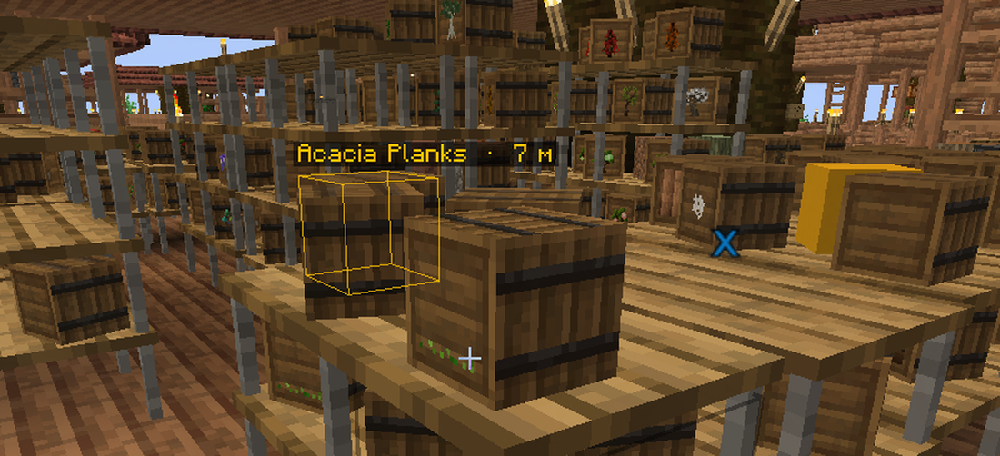
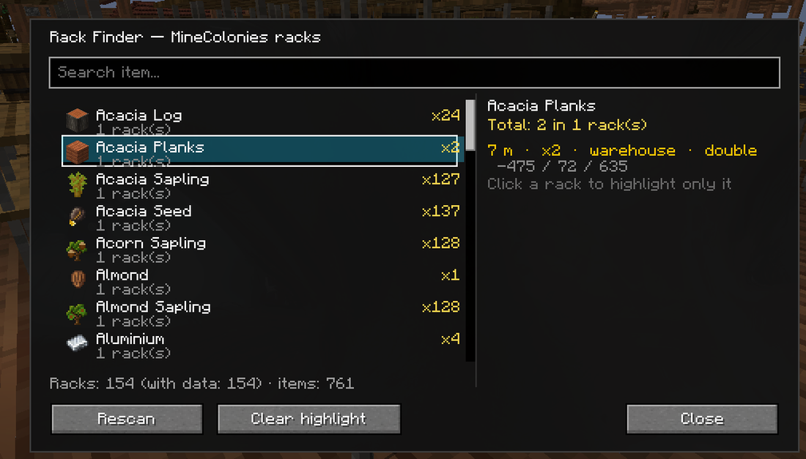
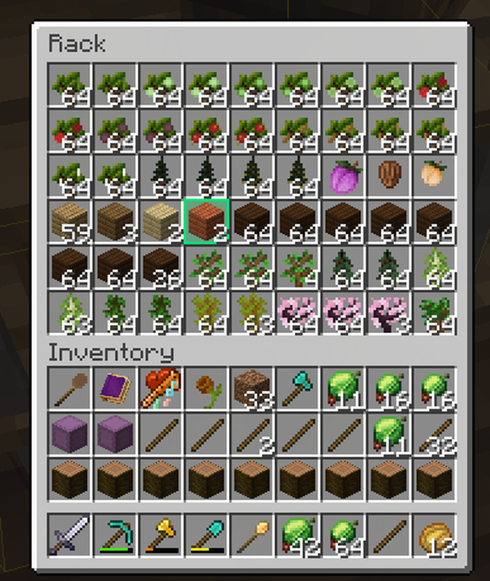

# MineColonies Rack Finder

[](https://github.com/Redd1ssKA/minecolonies-rackfinder/releases)
[](LICENSE)


[](https://github.com/Redd1ssKA/minecolonies-rackfinder/actions/workflows/build.yml)

**Client-side item search for [MineColonies](https://github.com/ldtteam/minecolonies) racks and vanilla
storage (Forge 1.20.1).** Press `R`, type an item name, and every container that stores it is outlined
**through walls** with its coordinates and distance. No server installation, no custom packets — it works
on any server.



*In game: the nearest matching rack is outlined through the wall, with a distance label and a HUD entry.*



*Search window: type a name, pick an item, see every rack that stores it.*



*Open the rack: slots that hold the item are framed in green.*

> Unofficial addon. Not affiliated with or endorsed by the MineColonies team (ldtteam).
> Русская версия: [README.ru.md](README.ru.md)

---

## Features

- **One key, full warehouse.** `R` opens a search window with every known item, its total amount and a
  list of containers that hold it (block name, distance, `X / Y / Z`).
- **Keyboard first.** Type, walk the list with `Up`/`Down`, confirm with `Enter` — the field keeps the
  focus the whole time and the window closes on confirmation.
- **Through-wall highlight.** Racks are outlined with screen-space boxes, so walls, floors and
  vegetation never hide them. The nearest rack is golden, the rest are cyan.
- **Clear HUD.** Nearest results are listed in the corner while the highlight is active; world labels
  show item name and distance.
- **Slot frames in the rack window.** Pick an item in the search window and matching slots get a green
  frame inside any container GUI (the rack window included), so you see the stack itself, not just the block.
- **Live outline.** The highlight follows the index: open a chest that contains the searched item and it
  joins the outline immediately, no need to search again.
- **Scrollable result list.** When more containers hold the item than fit on screen, scroll the
  right-hand list with the mouse wheel — the footer shows `1–7 of 23`.
- **Vanilla storage too.** Chests, trapped chests, barrels, shulker boxes, hoppers, droppers,
  dispensers, furnaces and brewing stands are indexed as well. Vanilla does not send their contents to
  clients, so a container is remembered the first time you open it (racks are picked up automatically).
- **Warehouse & double racks.** Marked in the results. A double rack is two blocks, so it shows twice
  (those are two real blocks).
- **Remembers your query.** The last search text comes back when you reopen the window; the "x" in the
  field clears it. The highlight changes only when you confirm an item.
- **Persistent index.** Everything is saved to `config/rackfinder/racks-<world>.json` and restored on
  the next login, so racks in unloaded chunks remain searchable.
- **Commands:** `/rackfinder open | target | rescan | dump | save | clear`.

## How it works (and why the server is not needed)

The mod only uses data the client already receives:

1. **Loaded chunks.** A chunk packet carries the NBT of every block entity via
   `BlockEntity#getUpdateTag()`. MineColonies' rack returns `saveWithId()` → `saveAdditional()`, which
   contains the whole inventory (tags `inventory`, `empty`, `inWarehouse`). The mod reads that data and
   builds an item → racks index.
2. **Opened containers.** Opening a rack GUI sends the fresh slot contents to the client; the mod
   records that snapshot and refreshes its entry.
3. **Opened vanilla containers.** For chests, barrels, shulkers and the like the client only learns the
   contents while the GUI is open, so the mod records the snapshot then (and attributes it to the block
   you right-clicked).

Consequences:

- Racks in already loaded chunks are found automatically — no need to open them.
- Racks outside loaded chunks stay searchable from the last snapshot on disk.
- A chunk that stayed loaded can hold slightly stale contents (colonists moved items, no re-sync).
  Press **Rescan** in the window or simply open that rack to refresh it.
- `displayTest="IGNORE_ALL_VERSION"` means servers and other players don't see the mod at all.

## Installation

1. Download `rackfinder-1.20.1-<version>.jar` from [Releases](https://github.com/Redd1ssKA/minecolonies-rackfinder/releases).
2. Drop it into your `mods/` folder (Forge 1.20.1, client only).
3. Start the game. If `R` is already taken: **Options → Controls → Key Binds → Rack Finder**.

MineColonies itself is an optional dependency: without it the mod simply finds nothing.

## Commands & config

| Command | What it does |
|---|---|
| `/rackfinder open` | opens the search window |
| `/rackfinder dump` | prints index stats and the top items into chat |
| `/rackfinder rescan` | rescans loaded chunks |
| `/rackfinder save` | writes the index to disk now |
| `/rackfinder target` | prints the item used for slot frames |
| `/rackfinder clear` | wipes the index |

`config/rackfinder-client.toml`:

| Key | Default | Meaning |
|---|---|---|
| `scan.radiusChunks` | 8 | chunk radius inspected around the player |
| `scan.intervalTicks` | 20 | how often new chunks are picked up |
| `scan.fullRefreshSeconds` | 120 | full re-read of loaded racks (0 = off) |
| `highlight.maxHighlights` | 128 | maximum outlines at once |
| `highlight.maxLabels` | 10 | world labels |
| `highlight.hudList` | true | nearest-racks list in the corner |
| `highlight.autoHighlight` | true | highlight on selection |
| `inventory.slotHighlight` | true | green frame on matching slots inside container GUIs |
| `storage.autoSaveSeconds` | 30 | index autosave |
| `misc.chatFeedback` | true | chat messages on login/rescan |

## Compatibility

- Minecraft **1.20.1**, Forge **47.x** (developed and built against 47.4.10).
- MineColonies **1.20.1-1.x** (internals verified against `1.20.1-1.1.1278`).
- Client only; nothing to install on the server, no extra network traffic.

## Building

```bash
git clone https://github.com/Redd1ssKA/minecolonies-rackfinder.git
cd minecolonies-rackfinder
export JAVA_HOME=/path/to/jdk17
./gradlew build          # -> build/libs/rackfinder-1.20.1-<version>.jar
```

JDK 17 and access to `maven.minecraftforge.net` are required (ForgeGradle downloads Minecraft 1.20.1
and Forge). The first build takes a few minutes.

A headless self-test of the rack NBT parser, the index, search and JSON persistence runs on the dev
server:

```bash
./gradlew runServer     # prints [selftest] ok ... and stops
```

## Known limitations

- Racks are indexed automatically from loaded chunks; vanilla containers only after you open them at
  least once. Ender chests and container minecarts are not supported.
- Containers in unloaded chunks use the last known snapshot (timestamped in the index file).
- Contents can be stale if a chunk never reloaded after a change.

## Roadmap

- [ ] Optional indexing of vanilla containers
- [ ] Arrow / waypoint to the nearest matching rack
- [ ] Optional quick search from the recipe viewer (JEI / EMI)

## License

[MIT](LICENSE) © Redd1ssKA
