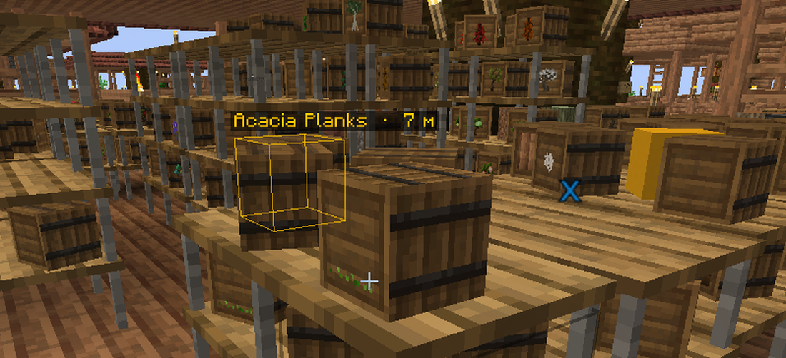
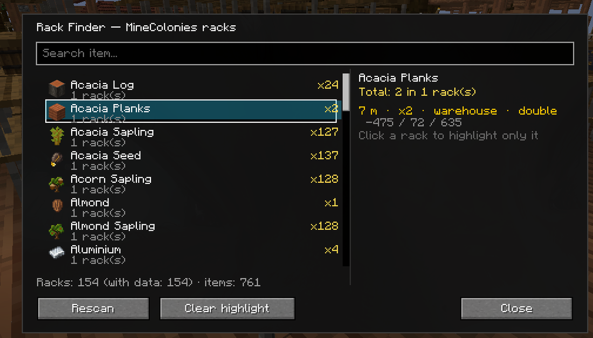
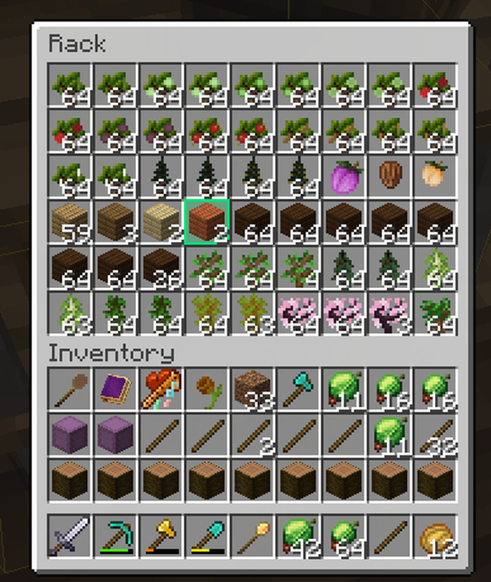

# MineColonies Rack Finder


Клиентский мод для Forge 1.20.1: поиск предметов по стойкам MineColonies и ванильным хранилищам
(сундуки, бочки, шалкеры, воронки, раздатчики, печи и т.п.). Нажал `R`, ввёл название — все контейнеры
с этим предметом подсвечиваются **сквозь стены** с координатами и дистанцией. **Сервер трогать не
нужно**: нет установки на сервер, нет своих пакетов.



*В игре: ближайшая стойка подсвечена сквозь стену, с дистанцией и записью в HUD.*



*Окно поиска: вводишь название, выбираешь предмет — видно все стойки с ним.*



*Открыл стойку: слоты с этим предметом обведены зелёным.*

> Неофициальный аддон. Не связан с командой MineColonies (ldtteam).

---

## Возможности

- `R` — окно поиска: все известные предметы, суммарное количество и список стоек (дистанция + `X / Y / Z`).
- Подсветка **сквозь стены**: ближайшая стойка золотая, остальные голубые; в углу — список ближайших.
- **Помнит запрос:** последний ввод восстанавливается при открытии окна; «×» очищает поле. Подсветка
  меняется только после подтверждения предмета.
- **Клавиатура:** ввёл название, `↑`/`↓` — выбор в списке, `Enter` — подтвердить и закрыть окно; фокус
  из поля ввода не уходит.
- **Рамки слотов в стойке:** выбрал предмет в окне поиска — в открытом окне стойки (и любом другом
  контейнере) слоты с этим предметом обводятся зелёной рамкой, видно саму стопку, а не только блок.
- **Живая подсветка:** открыл сундук с искомым предметом — его контур появляется сразу, повторно
  искать не нужно. Близкие контейнеры подсвечиваются частичным контуром, а не пропадают.
- **Прокрутка результатов:** если контейнеров с предметом больше, чем влезает в панель, список
  прокручивается колесом мыши, внизу показано `1–7 из 23`.
- **Ванильные хранилища:** сундуки, бочки, шалкеры, воронки, раздатчики, печи и варочные стойки.
  Ваниль не отправляет их содержимое клиенту, поэтому контейнер запоминается при первом открытии;
  стойки MineColonies индексируются автоматически.
- Метки `склад` и `двойная`; иконки предметов; выбор по клику.
- Индекс сохраняется в `config/rackfinder/racks-<мир>.json` — стойки в выгруженных чанках остаются
  доступными для поиска.
- Команды: `/rackfinder open | target | rescan | dump | save | clear`.

## Почему работает без серверной части

Используются только данные, которые клиент и так получает:

1. **Загруженные чанки.** В пакете чанка приходит NBT всех блок-сущностей через
   `BlockEntity#getUpdateTag()`. У стойки MineColonies это `saveWithId()` → `saveAdditional()` с полным
   инвентарём (теги `inventory`, `empty`, `inWarehouse`). Мод читает его и строит индекс «предмет → стойки».
2. **Открытие стойки.** При открытии GUI сервер присылает актуальные слоты — мод обновляет запись.
3. **Открытие ванильных контейнеров.** Содержимое сундуков и прочего клиент узнаёт только пока GUI
   открыт — мод запоминает снимок и привязывает его к блоку, по которому ты кликнул.

Следствия:

- Стойки в загруженных чанках находятся автоматически, открывать их не нужно.
- Стойки вне загруженных чанков ищутся по последнему снимку с диска.
- Если чанк долго был загружен, данные могут быть немного устаревшими (колонисты перекладывали
  предметы). Кнопка **Обновить** или открытие стойки освежает данные.
- `displayTest="IGNORE_ALL_VERSION"` — сервер и другие игроки мод не видят.

## Установка

1. Скачай `rackfinder-1.20.1-<версия>.jar` из [Releases](https://github.com/Redd1ssKA/minecolonies-rackfinder/releases).
2. Положи в `mods/` профиля Forge 1.20.1 (только клиент).
3. Запусти игру. Если `R` занята: **Настройки → Управление → Клавиши → Rack Finder**.

MineColonies — необязательная зависимость: без него мод просто ничего не находит.

## Сборка

```bash
git clone https://github.com/Redd1ssKA/minecolonies-rackfinder.git
cd minecolonies-rackfinder
export JAVA_HOME=/path/to/jdk17
./gradlew build          # -> build/libs/rackfinder-1.20.1-<версия>.jar
```

Нужен JDK 17 и доступ к `maven.minecraftforge.net`. Headless self-test парсера/индекса/поиска/сохранения:

```bash
./gradlew runServer      # печатает [selftest] ok ... и останавливается
```

## Совместимость

- Minecraft **1.20.1**, Forge **47.x** (сборка под 47.4.10).
- MineColonies **1.20.1-1.x** (проверено по внутренностям `1.20.1-1.1.1278`).
- Только клиент; на сервер ничего ставить не нужно.

## Ограничения

- Стойки индексируются автоматически из чанков; ванильные контейнеры — только после того, как ты их
  откроешь. Эндер-сундуки и контейнеры-вагонетки не поддерживаются.
- Контейнеры в выгруженных чанках — по последнему снимку (с отметкой времени в файле индекса).
- Данные могут быть неактуальными, если чанк не перезагружался после изменений.

## Лицензия

[MIT](LICENSE) © Redd1ssKA
